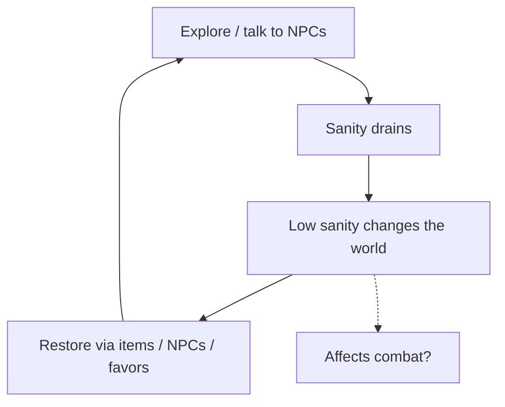
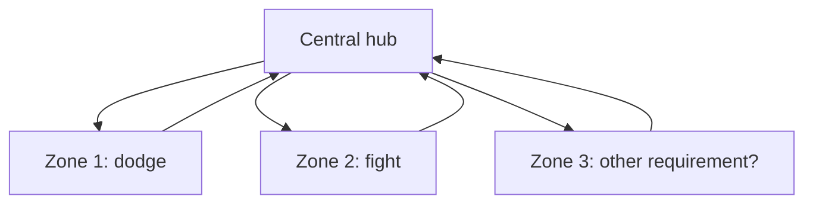

# Functional Design Document

see also: [TDD](<./TDD.md>)

Legend:
- bullet: decided
- `[ ]` still to decide

> [!NOTE]- who does what?
> Erin:
> - artstyle
> - artist
>
> Dean:
> - programmer
> - level design
>
> Mink:
> - miscellaneous worker ant
> - game development advice
> - idk maybe he can like play shitty guitar

---

## General Description

A psychological horror adventure driven by story and narrative, set in a closed world with multiple choice. It plays in a fantasy Celtic mythological faeric world. The Celtic world does exist, but the main character is not from it. The main character slowly goes mentally insane. (can ofc be changed)

Core pillars:
- 2.5D
- Nonlinear story/dialogue
- Fantasy Celtic mythologic faeric
- Psychological horror
- Strong story/narrative
- [ ] RPG?
- Sanity meter

Mood: surreal/dreamlike, "whimsical horror", heavy atmosphere. 
see inspirations in: [deans moodboard for huge breakthough project](<./deans moodboard for huge breakthough project.canvas>), (mood/vibe only, not gameplay, narrative, 3d/2d, UI or artstyle).

> [!question] Unclear
> - [ ] what will the Exact genre name be? idk tf to call it, name later if we are further in development? kinda important as then we can reference and compare our game to others and such.

## Perspective and Visuals

- 2.5D, like Octopath Traveler or Illusion Carnival
- Player is 2D, third person camera and viewpoint
- Sprites always face the camera (also the player), so sides never need to be drawn
- [ ] Environment built in Blender (3D props/environments) or as 2D layers rendered on top of each other like Illusion Carnival?
	- Owner: Erin. 
- [ ] Player style:
	- [ ] low-res/pixel player against high-res surroundings
	- [ ] unique non-pixel style
	- Owner: Erin.
- [ ] Art style: see for exact drawing and inspirations and inspirations [Erin's visual ideas](<./Erin's visual ideas.canvas>) 
	- Erin vote: 2D painterly watercolor, maybe 3D if time allows
	- Dean vote: the first painterly blitch/arcyllic, and the painterly watercolor style
	- Celtic-style elements are liked
	- Owner: Erin.
- [ ] Separate moodboards/example canvases for gameplay and artstyle
	- Owner: Dean.

## Stuff

- Sanity: a meter that changes how the game behaves
- Choices and consequences: what you say and do changes the course of the game
- Favors: talk to NPCs, trade favors, get things back
- Exploration: closed world, but you can go back and find hidden things

## Functional Requirements

### Movement

- [ ] Which abilities stay (jump, wall slide, crouch, dash)
	- Tie to level design.

### Sanity

- The player has a sanity meter
- [ ] The meter drains over time and/or through events
- [ ] Items, objects and NPCs can restore it
- [ ] Low sanity changes the world (visuals, sound, dialogue, enemies)
-  Must not be a minor annoyance, and must not make the game unplayable
	- (or maybe must make it inplayable if the player ignores everything?)

> [!question] Unclear
> - [ ] Environmental damage, where the meter fills up in a certain proximity of something

Sanity loop (just sketch):

### Dialogue and Choices

- Nonlinear story/dialogue
- [ ] Choices change NPC opinion (hidden fairy meter?) and the story
- [ ] Everything has a consequence, nothing is a fake choice 
	- Define minimum consequence per choice.
- [ ] Good/bad side leads to a fake ending, the true ending is hidden (talk to a hidden NPC?)

### Story

- see [Erin's visual ideas](<./Erin's visual ideas.canvas>) for erin minimum storyboard

 - [ ] Fairies stole your name, trade favors to get it back (and maybe steal theirs)
 - [ ] Set it in the Celtic world directly instead of isekai-ing the main character

### Quests / Favors

- [ ] NPCs give favors/quests
	- Define structure and tracking.
- [ ] Rewards are items, info, or sanity
	- Define economy? or is that more lore stuff that we dont need RN

### World

- Closed world, split into zones (idk, like some interconnected weave like yume 2kki ? <https://explorer.yume.wiki/>)
- Checkpoints and level progress are saved
- [ ] Eventually find someone for map design and level structuring
- [ ] Central hub where you dive deeper into the fairy realm, each zone with its own requirements (one where you dodge, one where you fight, etc)
- [ ] Randomized items

World structure idea visualized by dean:

### Combat

> [!failure] Blocker
> Combat system needs a decision before combat can be designed.(create moodboard thing for that(combatboard?))

- [ ] Small and tactical
	- [ ] Omori/Undertale like battle system
	- [ ] Fire Emblem or Cadence of Hyrule like (sanity can be way more challenging there)
- [ ] Sanity affects combat

### Audio

- Diverse and immersive music and sounds, as part of the atmosphere

## Non-functional Requirements

### Platform

- [ ] PC, Phone or Web
	-  for now just small formfactor laptop

## Workflow / Production Thingies

- Minimum 1 small progress step per week per person (draw 1 line, 1 bugfix, check in)
- ARCHIVE folder for old reusable assets (sorted with TagStudio)
- Erin does artstyle and sometimes ask dean for feedback
- Dean does level design
- Friends can join temporarily, or permanently as extra teammates, does need discusion
- Funding
	- Simple donation page
	- [ ] Funding plan
- [ ] Devlog/blogpost: weekly or other?
- [ ] Discord community server (when?)
- [ ] Shared gmail address

## Refinement of Each Requirement

Refine each requirement and include drawings below.

---
