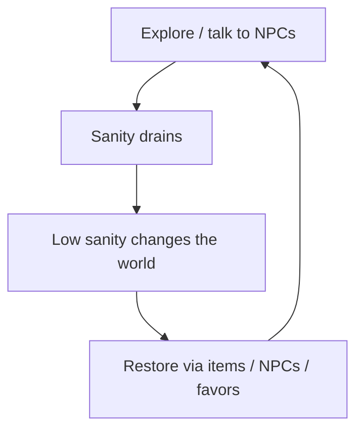

# Functional Design Document

> see also: [GDD](<./GDD.md>) for vision/story/world, [TDD](<./TDD.md>) for technical

> sources: [Gameplay moodboard thingie](<./Gameplay moodboard thingie.canvas>), [inventory ideas](<./inventory ideas.canvas>)

> [!error] to dean, from dean
> becarefull of scope creep, and perfectionism. i love adding ideas (see whole doc)

## Content in Doc

- [General Info](<#General Info>)
- [How to Write Requirement](<#How to Write Requirement>)
- [Functional Requirements](<#Functional Requirements>)
	- [Sanity](<#Sanity>)
	- [Dialogue + Choices](<#Dialogue + Choices>)
	- [NPCs](<#NPCs>)
	- [Quests + Favors](<#Quests + Favors>)
	- [Combat](<#Combat>)
	- [Movement + Controls](<#Movement + Controls>)
	- [Camera](<#Camera>)
	- [Interaction](<#Interaction>)
	- [Inventory + Items](<#Inventory + Items>)
	- [Tutorial + Onboarding](<#Tutorial + Onboarding>)
	- [Map + Journal](<#Map + Journal>)
	- [Save + Menus](<#Save + Menus>)
- [Non-functional Requirements](<#Non-functional Requirements>)
	- [Platform & Performance](<#Platform & Performance>)
	- [Accessibility](<#Accessibility>)
	- [Multiplayer](<#Multiplayer>)
- [Open Questions](<#Open Questions>)
	- [Sanity](<#Open Questions#Sanity>)
	- [Dialogue + Choices](<#Open Questions#Dialogue + Choices>)
	- [NPCs](<#Open Questions#NPCs>)
	- [Quests + Favors](<#Open Questions#Quests + Favors>)
	- [Combat](<#Open Questions#Combat>)
	- [Movement + Controls](<#Open Questions#Movement + Controls>)
	- [Camera](<#Open Questions#Camera>)
	- [Interaction](<#Open Questions#Interaction>)
	- [Inventory + Items](<#Open Questions#Inventory + Items>)
	- [Tutorial + Onboarding](<#Open Questions#Tutorial + Onboarding>)
	- [Map + Journal](<#Open Questions#Map + Journal>)
	- [Save + Menus](<#Open Questions#Save + Menus>)
	- [Platform & Performance](<#Open Questions#Platform & Performance>)
	- [Multiplayer](<#Open Questions#Multiplayer>)
- [User Acceptance Test](<#User Acceptance Test>)

## General Info

- FDD = what game does: rules + numbers. why/vibe in [GDD](<./GDD.md>), code in [TDD](<./TDD.md>)
- sections = decided only. 
- open stuff in [Open Questions](<#Open Questions>)
- status: done = works in game / designed = decided, not built / open = needs decision
- priority: must / should / could

## How to Write Requirement

1. what player does
2. numbers
3. done when: how to check it
4. short + simple, prefered for now

## Functional Requirements

### Sanity

core pillar, so concrete, not just "you lose sanity" with no consequenses.

- 0 to 100, 4 stages at 25/50/75 
- drain:
	- flat per second in world
	- wrong dialogue choices, witnessing certain story events
	- proximity to certain objects
- pauses: during locking interactions + inside sanctuaries
- restore:
	- items (books, food etc), amount = per item
	- first time entering sanctuary, +15 (see below)
	- completing quest steps/objectives
	- NPC favors
- encounters, random + set: gain or lose sanity depending on choices
- lower stage = more world change:
	- stage 0 (75-100): baseline
	- stage 1 (50-75): minor unease. visuals in
	- stage 2 (25-50): stronger distortion, some NPC lines change, fake enemies may show up
	- stage 3 (0-25): heavy distortion, more fake enemies, some real threats
	- fake enemies: you dont know which are fake
- sanity 0: not decided, see [Open Questions](<#Open Questions>)

must not be minor annoyance, must not make game unplayable

sanctuaries (from [Gameplay moodboard thingie](<./Gameplay moodboard thingie.canvas>), Darkwood):

> status: half done (drain pause works)
> priority: must

- first entry: +15 sanity, once per sanctuary
- some objects inside restore extra sanity
- each sanctuary = 1 NPC or interesting interaction
- fixed locations, handcrafted
- never randomly become unsafe. only scripted (dying tree in tutorial)
- done when: enter sanctuary first time, sanity +15, second time nothing

sanity loop:

### Dialogue + Choices

- nonlinear story/dialogue
- [x] choices change NPC opinion + story

sanity in dialogue (from [Gameplay moodboard thingie](<./Gameplay moodboard thingie.canvas>), Disco Elysium):
- dialogue options can need minimum sanity
- low sanity replaces some options with other ones
- example, NPC asks where you came from:
	- high sanity: "I dont remember."
	- low sanity: "You know where. You sent me here."

### NPCs

> status: done (basic)
> priority: must

- talk, pick dialogue choices
- NPCs remember player actions ("world remembers")

### Quests + Favors

- economy: no. favors = economy. no shops, no currency. its celtic-pact thing anyway

numbers (from [Gameplay moodboard thingie](<./Gameplay moodboard thingie.canvas>), Majoras Mask):
- 4-5 important NPCs
- each has 1 relationship value (= fairy meter)
- each gives 1-2 favors
- NPC dialogue changes with relationship
- no reputation simulation, few values + conditional dialogue

### Combat

> [!failure] Blocker
> see Decisions in [GDD](<./GDD.md>), options in [Open Questions](<#Open Questions>). (create moodboard for that, combatboard?)

### Movement + Controls

walk, run, jump (double, variable height on release), wall slide, wall jump, dash (cooldown, limited per airtime), crouch. all in.

> status: done (keyboard movement + controls)
> priority: must

keyboard for now, gamepad + touchscreen later

### Camera

> status: done
> priority: could

- third person, 2.5D, perspective
- third-person perspective follow camera with damping
- a level can leave camera unassigned for fixed camera
- no free look, no player orbit
- slight mouse lean, see [GDD](<./GDD.md>)

### Interaction

> status: done
> priority: must

- press interact near something, closest one reacts
- things can be gated by item/flag, blocked until present
- picked up things stay gone after reload
- done when: gate opens with right item, stays open after reload

### Inventory + Items

> status: done (no visual yet)
> priority: must

- carry, use, give items
- pickup flow (from [inventory ideas](<./inventory ideas.canvas>)):
	- pick up by interact or walking over it
	- text: "you picked up *item*"
	- cant pick up yet (missing other item first): popup says so
	- NPC can give item (quest reward)
	- item shows in inventory
	- use: "you used *item*"
	- one time use: "*item* has been destroyed"
- done when: pick up book, see it, use it, sanity up

### Tutorial + Onboarding

> status: half designed
> priority: must

- story: see Tutorial in [GDD](<./GDD.md>)
- teach by doing: movement, interact, talk, choice, sanity drain, sanctuary, sanity restore
- no text popups if tree can say it
- done when: new player leaves forest w/o asking us

### Map + Journal

> status: open
> priority: could (map) / should (journal)

both are stubs. see [Open Questions](<#Open Questions>).

### Save + Menus

> status: done
> priority: must (save) / should (menus)

**Save + Load:**
- checkpoints, level progress, quest progress saved
- picked up items, per level flags saved
- checkpoints only, no manual save
- done when: continue puts you at checkpoint with same items, sanity

**Menus + Settings (placeholder look):**
- main menu, pause, options

## Non-functional Requirements

### Platform & Performance

- dev/test on small formfactor laptop for now
- ship to desktop + web. web = perf target
- Compatibility renderer, heavier only if needed
- 45 fps min on web, always
- languages + save compat: see [Open Questions](<#Open Questions>)

### Accessibility

- see accessibility list in [GDD](<./GDD.md>). every toggle gets a line here once decided

### Multiplayer

- other players show in same level, works offline (done)

## Open Questions

not decided yet. decided? move answer up into its section, delete here.

### Sanity

- [ ] drain: flat per second, how much
- [ ] drain: wrong dialogue choices/story events, how much per event
- [ ] drain: interacting with enemies? (running, fighting back etc)
- [ ] restore: quest steps/objectives, how much
- [ ] restore: NPC favors, which, how much
- [ ] sanctuary objects, how much extra sanity
- [ ] stage 1: sound ?
- [ ] numbers: how many fake enemies in stage 2+3, how many real threats in stage 3
- [ ] sanity 0: this = big open one. things:
	- fail forward: teleport to last sanctuary, lose progress (how much, not save), world remembers. no game over screen. fits hopeless vibe
	- checkpoint reload at reduced sanity (how much). standard, boring
	- sanity 0 = one of endings. aggressive, needs fake-ending system first
	- unlocking whole different world when your a dick? 
- [ ] (or maybe must make it inplayable if player ignores everything?)
- [ ] sanity affects combat?

### Dialogue + Choices

- [ ] (hidden fairy meter? like FUN value) opinion. keep as fairy meter or rename, same thing
- [ ] everything = consequence, nothing = fake choice
	- minimum consequence per choice: every player-facing choice writes at least 1 of fact, opinion delta, quest stage, item grant/removal, level flag, sanity delta. if it writes nothing, its fake choice, cut it or make it write something
- [ ] endings + true ending gating: see ending structure + Decisions in [GDD](<./GDD.md>)
- [ ] hallucination AI + just dialogue conditions ?

### NPCs

- [ ] NPCs move/schedule, or stand still?
- [ ] NPCs remember player actions: which ones, how long?
- [ ] how NPCs show opinion
- [ ] low sanity changes some lines (stage 2+). alt lines for every NPC or some?

### Quests + Favors

- [ ] NPCs give favors/quests
	- define structure + tracking (quests have stages, game remembers current stage. journal UI ?)
- [ ] rewards: item/info/sanity/new location access

### Combat

options:
- A) no combat. threats = dialogue/choice encounters. fighting back = dialogue option, costs sanity. fake vs real enemies resolved by interacting, not hitting. fits input surface + horror tone. buildable on what exists
	- encounters (from [Gameplay moodboard thingie](<./Gameplay moodboard thingie.canvas>), Little Nightmares):
		- 5-8 handcrafted encounters
		- 2-3 choices each: decide, escape, or interact with dangerous thing
		- choices hit sanity, NPC relationship, or inventory
		- some only at certain sanity levels
		- scripted, no enemy AI
- B) small + tactical. whole new system, not built
	- [ ] turn-based Undertale/Omori like. input = choices + maybe timed minigame
	- [ ] fire emblem or cadence of hyrule like (sanity can be way more challenging there)
- C) real time
	- [ ] real time combat, you have button to swing weapon to deal damage
	- [ ] enemy touch/hit = lose sanity
	- [ ] enemy dies after few hits
- combat/interaction FDD:
	- you have like a branch + when fighting, almost always moving

### Movement + Controls

- [ ] which abilities stay per zone 
	- [ ] tie to level design?
- [ ] web: keyboard only ok?
- [ ] list all actions (move, run, jump, dash, crouch, interact, pause, journal?)

### Camera

- [ ] camera changes per zone or low sanity (tilt, zoom)?

### Interaction

- [ ] interact prompt: look, shown at low sanity or lies?
- [ ] two things equally close?
- [ ] interact while dashing/in air?

### Inventory + Items

- [ ] inventory size limit?
- [ ] inventory UI. see [inventory ideas](<./inventory ideas.canvas>). like minecraft hotbar or point n click HUD
- [ ] pick up by interact or walking over it, which one, or both per item
- [ ] drop items?
- [ ] fake items at low sanity?
- [ ] "shit equipment": what = equipment, does it do anything

### Tutorial + Onboarding

- [ ] list what = taught where

### Map + Journal

- [ ] map? no map = more lost, but people get stuck
- [ ] if yes, lies at low sanity?
- [ ] journal UI, exists at all? helps, but fits badly with lost/hopeless vibe. maybe diary unreliable at low sanity
- [ ] next objective shown or nothing

### Save + Menus

- [ ] old saves after updates add/change items/quests
- [ ] web saves: browser storage, can get wiped. warn player? print warning that player should clear cache? perhaps player can export json file with save?
- [ ] settings: volume, fullscreen + accessibility toggles (list in [GDD](<./GDD.md>))
- [ ] art style, wait for Erin

### Platform & Performance

- [ ] load time target, esp web (max first download size?)
- [ ] sanity visuals must hold 45 fps
- [ ] languages: english only
- [ ] save compatibility between versions

### Multiplayer

- [ ] feature or tech demo?

## User Acceptance Test

Check if game meets all functional, design + game requirements in perspective of player.

- [ ] Player can walk + run
- [ ] Player can jump, with variable height + double jump
- [ ] Player can wall slide + wall jump
- [ ] Player can dash, with cooldown
- [ ] Player can crouch
- [ ] Character faces direction it moves in
- [ ] Movement values can be changed through movement profile
- [ ] Player can talk to NPCs with dialogue + choices
- [ ] Player can interact with things, + gated ones stay blocked until item/flag is there
- [ ] Player can carry, use + give items
- [ ] Picked up items stay gone after reload
- [ ] Quest progress = saved + restored
- [ ] Sanity drains + screen changes per sanity stage
- [ ] Checkpoints + level progress = saved + restored on continue
- [ ] Other players show up in same level, + game still works offline
- [ ] Game does not lag or drop below 45 FPS on web.