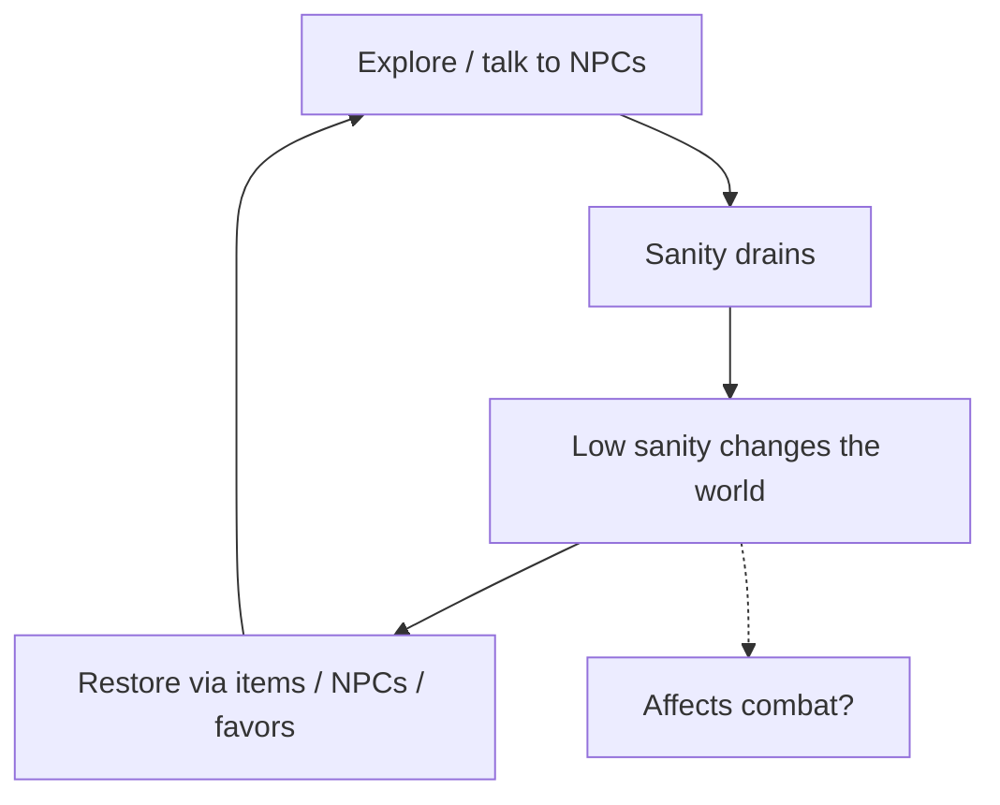

# Functional Design Document

> see also: [GDD](<GDD.md>) for vision/story/world, [TDD](<TDD.md>) for technical

Legend:
- bullet: decided
- `[ ]` still to decide

## Functional Requirements

### Movement

code has walk, run, jump (double, variable height on release), wall slide, wall jump, dash (cooldown, limited per airtime), crouch. all in.

- [ ] which abilities stay per zone 
	- [ ] (tie to level design?

### Sanity

sanity is core pillar so it needs to be concrete, not just "you lose sanity" with no numbers. what the code already does + what to fill in:

- 0 to 100, 4 zones at 25/50/75 
- drain: flat per second in the world, plus event drains from wrong dialogue, story beats, interacting with enemies, proximity to certain objects
- pauses: during locking interactions, and inside sanctuaries
- restore: items (sanity_restore on ItemData), first time entering a safe space, completing quest steps, some NPC favors
- low zone changes the world per zone:
	- zone 0 (75-100): baseline
	- zone 1 (50-75): minor unease. visuals in, sound [ ]
	- zone 2 (25-50): stronger distortion, some NPC lines change, fake enemies may show up
	- zone 3 (0-25): heavy distortion, more fake enemies, some real threats
- sanity 0: [ ] this is big open one. things:
	- fail forward: teleport to last sanctuary, lose some progress (not the save), world remembers. no game over screen. fits the hopeless vibe
	- checkpoint reload at reduced sanity. standard, boring
	- sanity 0 is one of the endings. aggressive, needs the fake-ending system first
	- pick one before touching SanityComponent again, the code comment is literally waiting on this
	- unlocking a whole different world when your a dick? 

must not be a minor annoyance, and must not make the game unplayable
- (or maybe must make it inplayable if the player ignores everything?)

- there will be random and set encounters where you can gain or lose sanity depending on the choices you make during that encounter
- you can regain sanity by using certain items (books, food etc)
- you regain some sanity when you enter a safe space for the first time
- you can gain some sanity when completing objectives
- you lose sanity by interacting with enemies? (running, fighting back etc)
- you lose sanity by making wrong dialogue choices or witnessing certain story events
- when you low sanity, there will be a lot of enemies, but some are like fake and you dont know which are fake
- [x] environmental damage, where the meter fills up in a certain proximity of something

Sanity loop (sketch):

### Dialogue and Choices

- nonlinear story/dialogue
- [x] choices change NPC opinion and the story
	- [ ] (hidden fairy meter? like a FUN value) opinion. keep it as the fairy meter or rename, same thing
- [ ] everything has a consequence, nothing is a fake choice
	- minimum consequence per choice: every player-facing choice writes at least one of fact, opinion delta, quest stage, item grant/removal, level flag, sanity delta. if it writes nothing, it's a fake choice, cut it or make it write something
- [ ] good/bad side leads to a fake ending, the true ending is hidden
	- [ ] (talk to a hidden NPC?)  decide gating shape before writing endgame dialogue

### Quests / Favors

- [ ] NPCs give favors/quests
	- define structure and tracking (QuestData with stages, fact quest.<id> = current stage. journal UI [ ])
- [ ] rewards are items, info, or sanity
	- economy: no. favors are the economy. no shops, no currency. it's the celtic-pact thing anyway

### Combat

> [!failure] Blocker
> combat needs a decision before combat can be designed. (create moodboard for that, combatboard?)

options:
- A) no combat. threats are dialogue/choice encounters. fighting back is a dialogue option that costs sanity. fake vs real enemies resolved by interacting, not hitting. fits the input surface + horror tone. buildable on what exists
- B) turn-based Undertale/Omori. input is choices + maybe a timed minigame. whole new system, not built

- [ ] pick A or B before designing any

- [ ] small and tactical
	- [ ] omori/undertale like battle system
	- [ ] fire emblem or cadence of hyrule like (sanity can be way more challenging there)
- [ ] sanity affects combat
- combat/interaction FDD:
	- you have like a branch and when your fighting, your almost always moving

## Non-functional Requirements

### Platform

- dev/test on small formfactor laptop for now
- ship to desktop + web . web is the perf target, never below 45 fps