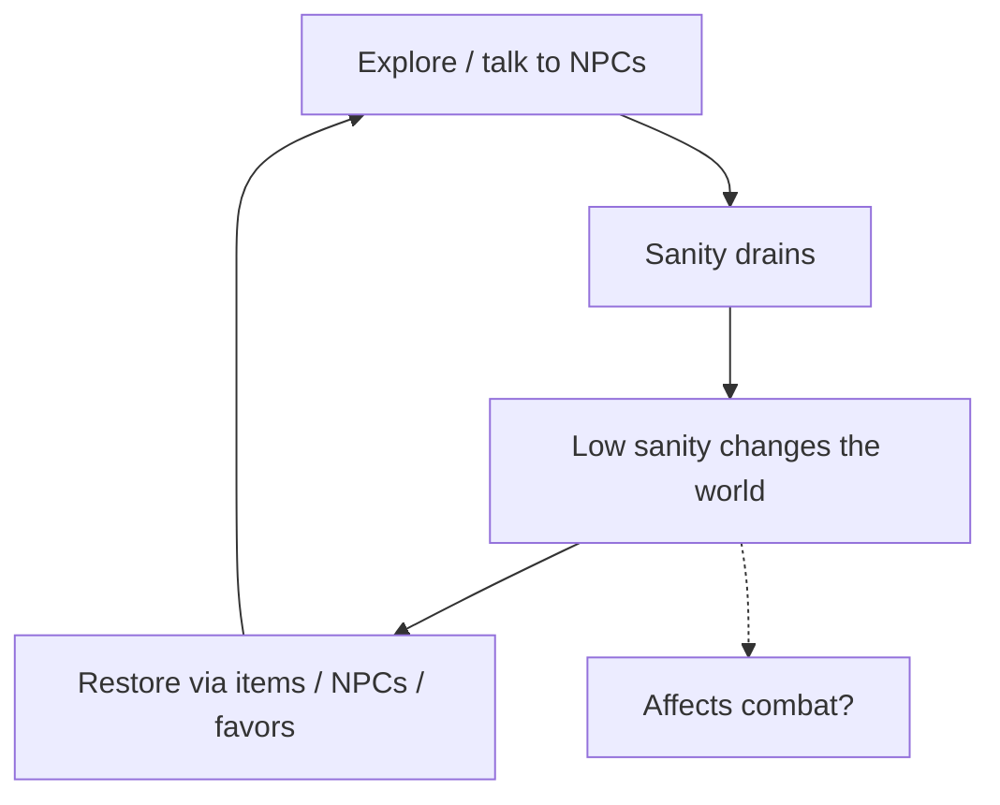

# Functional Design Document

> see also: [GDD](<./GDD.md>) for vision/story/world, [TDD](<./TDD.md>) for technical

> sources: [Gameplay moodboard thingie](<./Gameplay moodboard thingie.canvas>), [inventory ideas](<./inventory ideas.canvas>)

status:
- done = works in game
- designed = decided, not built
- open = needs decision

priority: 
1. must 
2. should
3. could

## How to Write Requirement

1. what the player does
2. numbers
3. when its done
4. short and simple is fine, its even prefered for now

## Functional Requirements

### Sanity

sanity is core pillar so it needs to be concrete, not just "you lose sanity" with no consequenses. what the game already does + what to fill in:

- 0 to 100, 4 zones at 25/50/75 
- drain:
	- flat per second in the world [ ] how much
	- wrong dialogue choices, witnessing certain story events [ ] how much per event
	- interacting with enemies? (running, fighting back etc)
	- proximity to certain objects
- pauses: during locking interactions, and inside sanctuaries
- restore:
	- items (books, food etc), amount set per item
	- first time entering sanctuary, +15 (see below)
	- completing quest steps / objectives [ ] how much
	- NPC favors [ ] which, how much
- encounters, random and set: gain or lose sanity depending on choices
- low zone changes the world per zone:
	- zone 0 (75-100): baseline
	- zone 1 (50-75): minor unease. visuals in, sound ?
	- zone 2 (25-50): stronger distortion, some NPC lines change, fake enemies may show up
	- zone 3 (0-25): heavy distortion, more fake enemies, some real threats
	- fake enemies: you dont know which are fake
	- [ ] numbers: how many fake enemies in zone 2 and 3, how many real threats in zone 3
- sanity 0: [ ] this is big open one. things:
	- fail forward: teleport to last sanctuary, lose progress ([ ] how much, not the save), world remembers. no game over screen. fits the hopeless vibe
	- checkpoint reload at reduced sanity ([ ] how much). standard, boring
	- sanity 0 is one of the endings. aggressive, needs the fake-ending system first
	- unlocking a whole different world when your a dick? 

must not be a minor annoyance, and must not make the game unplayable
- (or maybe must make it inplayable if the player ignores everything?)

safe spaces / sanctuaries (from [Gameplay moodboard thingie](<./Gameplay moodboard thingie.canvas>), Darkwood):

> status: half done (drain pause works), priority: must

- first entry: +15 sanity, once per sanctuary
- some objects inside restore extra sanity [ ] how much
- each sanctuary has 1 NPC or interesting interaction
- fixed locations, handcrafted
- never randomly become unsafe. only scripted (dying tree in tutorial)
- done when: enter sanctuary first time, sanity +15, second time nothing

Sanity loop (sketch):

### Dialogue and Choices

- nonlinear story/dialogue
- [x] choices change NPC opinion and the story
	- [ ] (hidden fairy meter? like a FUN value) opinion. keep it as the fairy meter or rename, same thing
- [ ] everything has a consequence, nothing is a fake choice
	- minimum consequence per choice: every player-facing choice writes at least one of fact, opinion delta, quest stage, item grant/removal, level flag, sanity delta. if it writes nothing, it's a fake choice, cut it or make it write something
- [ ] good/bad side leads to a fake ending, the true ending is hidden
	- [ ] (talk to a hidden NPC?)

sanity in dialogue (from [Gameplay moodboard thingie](<./Gameplay moodboard thingie.canvas>), Disco Elysium):
- dialogue options can need minimum sanity
- low sanity replaces some options with other ones
- example, NPC asks where you came from:
	- high sanity: "I don't remember."
	- low sanity: "You know where. You sent me here."
- hallucination AI + just dialogue conditions ?

### Quests / Favors

- [ ] NPCs give favors/quests
	- define structure and tracking (quests have stages, game remembers current stage. journal UI [ ])
- [ ] rewards: item, info, sanity, or access to new location
	- economy: no. favors are the economy. no shops, no currency. it's the celtic-pact thing anyway

numbers (from [Gameplay moodboard thingie](<./Gameplay moodboard thingie.canvas>), Majora's Mask):
- 4-5 important NPCs
- each has 1 relationship value (= fairy meter)
- each gives 1-2 favors
- NPC dialogue changes with relationship
- no reputation simulation, few values + conditional dialogue

### NPCs

> status: done (basic), priority: must

- talk, pick dialogue choices
- [ ] NPCs move / schedule, or stand still?
- [ ] NPCs remember player actions (yes, "world remembers"). which ones, how long?
- [ ] how NPCs show opinion
- [ ] low sanity changes some lines (zone 2+). alt lines for every NPC or some?

### Combat

> [!failure] Blocker
> see Blocking Decisions. (create moodboard for that, combatboard?)

options:
- A) no combat. threats are dialogue/choice encounters. fighting back is a dialogue option that costs sanity. fake vs real enemies resolved by interacting, not hitting. fits the input surface + horror tone. buildable on what exists
	- encounters (from [Gameplay moodboard thingie](<./Gameplay moodboard thingie.canvas>), Little Nightmares):
		- 5-8 handcrafted encounters
		- 2-3 choices each: decide, escape, or interact with dangerous thing
		- choices hit sanity, NPC relationship, or inventory
		- some only at certain sanity levels
		- scripted, no enemy AI
- B) small and tactical. whole new system, not built
	- [ ] turn-based Undertale/Omori like. input is choices + maybe a timed minigame
	- [ ] fire emblem or cadence of hyrule like (sanity can be way more challenging there)
- C) real time
	- [ ]  real time combat, you have a button to swing a weapon to deal damage
	- [ ] enemy touches/hits you = lose sanity
	- [ ] enemy dies after few hits

- [ ] sanity affects combat
- combat/interaction FDD:
	- you have like a branch and when your fighting, your almost always moving

### Movement

walk, run, jump (double, variable height on release), wall slide, wall jump, dash (cooldown, limited per airtime), crouch. all in.

- [ ] which abilities stay per zone 
	- [ ] tie to level design?

### Interaction

> status: done, priority: must

- press interact near something, closest one reacts
- things can be gated by item or flag, blocked until present
- picked up things stay gone after reload
- [ ] interact prompt: look, shown at low sanity or lies?
- [ ] two things equally close?
- [ ] interact while dashing / in air?
- done when: gate opens with right item, stays open after reload

### Inventory and Items

> status: done (no visual yet), priority: must

- carry, use, give items
- [ ] inventory size limit?
- [ ] inventory UI. see [inventory ideas](<./inventory ideas.canvas>). like minecraft hotbar or point n click HUD
- pickup flow (from [inventory ideas](<./inventory ideas.canvas>)):
	- pick up by interact or walking over it [ ] which one, or both per item
	- text: "you picked up *item*"
	- cant pick up yet (missing other item first): popup says so
	- NPC can give item (quest reward)
	- item shows in inventory
	- use: "you used *item*"
	- one time use: "*item* has been destroyed"
- [ ] drop items?
- [ ] fake items at low sanity?
- [ ] "shit equipment": what is equipment, does it do anything
- done when: pick up book, see it, use it, sanity up

### Tutorial / Onboarding

> status: half designed, priority: must

- story: see Cool Beginning in [GDD](<./GDD.md>)
- teach by doing: movement, interact, talk, choice, sanity drain, sanctuary, sanity restore
- [ ] list what is taught where. no text popups if tree can say it
- done when: new player leaves forest without asking us

### Map

> status: open, priority: could

- [ ] map? no map feels more lost, but people get stuck
- [ ] if yes, lies at low sanity?

### Journal / Quest Tracker

> status: open, priority: should

- [ ] journal UI, exists at all? helps, but fits badly with lost / hopeless vibe. maybe diary unreliable at low sanity
- [ ] next objective shown or nothing

### Save and Load

> status: done, priority: must

- checkpoints, level progress, quest progress saved
- picked up items, per level flags saved
- [ ] manual save or checkpoints only? (checkpoints only is plan)
- [ ] old saves after updates add or change items / quests
- [ ] web saves: browser storage, can get wiped. warn player? print a warning that player should clear cache? perhaps player can export json file with safe?
- done when: continue puts you at checkpoint with same items, sanity

### Menus and Settings

> status: done (placeholder look), priority: should

- main menu, pause, options
- [ ] settings: volume, fullscreen, key remap, distortion strength (see accessibility in [GDD](<../yume nikki gamejam/GDD.md>))
- [ ] reskin to art style, wait for Erin

### Controls

> status: done (keyboard), priority: must

- [ ] gamepad?
- [ ] web: keyboard only ok?
- [ ] list all actions (move, run, jump, dash, crouch, interact, pause, [ ] journal)

### Camera

> status: done, priority: could

- third person, 2.5D
- [ ] camera changes per zone or low sanity (tilt, zoom)?

## Non-functional Requirements

### Platform

- dev/test on small formfactor laptop for now
- ship to desktop + web . web is the perf target
- Compatibility renderer, heavier only if needed

### Performance

- 45 fps minimum on web, always
- [ ] load time target, esp web (max first download size?)
- [ ] sanity visuals must hold 45 fps, probably heaviest part

### Accessibility

- see accessibility list in [GDD](<./GDD.md>). every toggle gets a line here once decided

### Compatibility

- [ ] languages: english only? decide before writing lots of dialogue
- [ ] save compatibility between versions

### Multiplayer

- other players show in same level, works offline (done)
- [ ] feature or tech demo?
