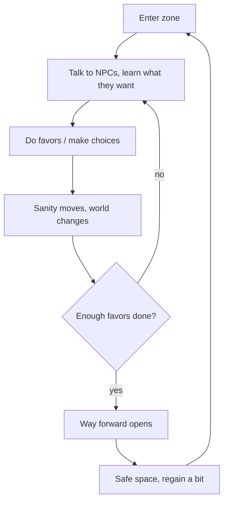
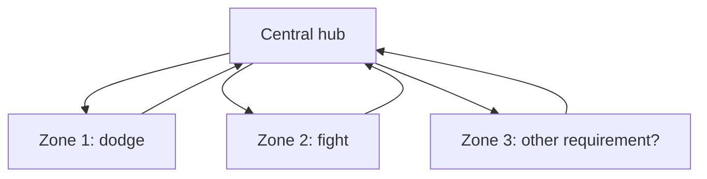

# Game Design Document

> see also: [FDD](<./FDD.md>) for functional, [TDD](<./TDD.md>) for technical

> [!NOTE]- who does what?
> Erin:
> - artstyle
> - artist
>
> Dean:
> - programmer
> - level design
>
> Mink:
> - miscellaneous worker ant
> - game development advice
> - idk maybe he can like play shitty guitar

---
# Cool Beginning Start of Game

#### First Tutorial Level
- You spawn in a forest with a large dying tree in the middle.(yggdrasil? deku tree? last of the great trees)
- You must interact with tree to progress, he will tell you he is dying and he will explain a little bit about the world you're in and how to survive.
- The area around the tree is a temporary safe hub
- You help the tree complete a few tasks and then he dies, the place he is in is no longer safe and you have to move on and survive with what youve learned
- sanity point needs to be concrete, like in how it works and what you get from it.

## General Description

Psychological horror adventure driven by story and narrative, set in a closed world with multiple choice. It plays in a fantasy Celtic mythological faeric world. The Celtic world does exist, but the main character is not from it. The main character slowly goes mentally insane. (can ofc be changed)

Core pillars:
- 2.5D
- Nonlinear story/dialogue
- Fantasy Celtic mythologic faeric
- Psychological horror
- Strong story/narrative
- [ ] RPG?
- Sanity meter

Mood: surreal/dreamlike, "whimsical horror", heavy atmosphere. 
see inspirations in: [deans moodboard for huge breakthough project](<./deans moodboard for huge breakthough project.canvas>), (mood/vibe only, not gameplay, narrative, 3d/2d, UI or artstyle).

the vibe of like progressing is that its hopeless, and you get like shit equipment?

> [!question] Unclear
> - [ ] what will the Exact genre name be? idk tf to call it, name later if we are further in development? kinda important as then we can reference and compare our game to others and such.

## Pitch Thing that Most Other GDD Related Stuff Have

one sentence, so anyone (us in 6 months) knows tf is:

- human stuck in faerie world that slowly eats your mind. only way out: trade favors with things that lie for a living.
- [ ] target player: story game people who tolerate discomfort (omori, undertale, lisa). not grinders

### What the Player Should Feel

- early: curious, bit lost, tree feels safe
- middle: paranoid. cant tell what is real, cant tell who lies
- late: traded away something unrecoverable
- never: bored from grinding, cheated by fake choice. choice have consequence, but that should not be explained, it should be felt

### What Game is NOT

deciding what its not collapses future choices and makes thing in the future be less work and more efficient:

- not combat focused game. combat is blocker, see [FDD](<./FDD.md>)
- not RPG with stats. no player levels, no upgrade system?(godamnit)
- not economy game. no shops, no currency, favors are money
- not open world. closed world, zones.
- not jump scare game. horror from atmosphere and sanity, not loud noises
	- [ ] not "kill X monsters" quest game?

### Comparable Games

needed for genre name above. one line each, what it is a comp for:

- Omori: [ ] 
- Undertale: [ ] 
- Illusion Carnival: [ ] (visuals)
- Yume 2kki: [ ] (world structure)
- Octopath Traveler: [ ] (2.5D)
	- [ ] more, find horror game with good sanity

## Perspective and Visuals

- 2.5D, like Octopath Traveler or Illusion Carnival(and others, need to create link specific moodboards)
- Player is 2D, third person camera and viewpoint
- Sprites always face the camera (also the player), so sides never need to be drawn
- [ ] Environment built in Blender (3D props/environments) or as 2D layers rendered on top of each other like Illusion Carnival?
	- Owner: Erin. 
- [ ] Player style:
	- [ ] low-res/pixel player against high-res surroundings
	- [ ] unique non-pixel style
	- Owner: Erin.
- [ ] Art style: see for exact drawing and inspirations and inspirations [Erin's visual ideas](<./Erin's visual ideas.canvas>) 
	- Erin vote: 2D painterly watercolor, maybe 3D if time allows
	- Dean vote: the first painterly blitch/arcyllic, and the painterly watercolor style
	- Celtic-style elements are liked
	- Owner: Erin.
- [ ] Separate moodboards/example canvases for gameplay and artstyle
	- Owner: Dean.

## Stuff

- Sanity: a meter that changes how the game behaves
- Choices and consequences: what you say and do changes the course of the game
- Favors: talk to NPCs, trade favors, get things back
- Exploration: closed world, but you can go back and find hidden things
- no upgrade system
- no level system (no player levels)

## Core Loop

FDD has sanity loop. this is "what player does" loop. draft:

- every minute: walk, find something or someone, interact, choose
- every zone: arrive, learn rules, do favors for locals, find way forward, leave more damaged
- whole game: lose name, trade favors to get it back, sanity drops throughout, end somewhere

- [ ] "skill" part? movement is all in code (dash, wall jump), where is it used. dodge zones? platforming between NPCs? decide with zone table below
- [ ] zone length

## Story

- see [Erin's visual ideas](<./Erin's visual ideas.canvas>) for erin minimum storyboard

 - [ ] Fairies stole your name, trade favors to get it back (and maybe steal theirs)
 - [ ] Set it in the Celtic world directly instead of isekai-ing the main character

### Story Bible (Some Game Have like a Design Bible)

will change alot when we have writing and lore and such. 
(one short paragraph each is enough for now)

- [ ] protagonist: who, why here, wants what. what "slowly goes insane" looks like across game
- [ ] name: what it does in this world, why fairies want it, what if never recovered
- [ ] fairies: one court or several? who is nice, who lies, who lies but nice
- [ ] dying tree: why dying, killed by what, returns later?
- [ ] world rules (fae cant lie? iron? food? usual celtic stuff, which to keep, which to drop)
- [ ] themes: what it is about under the horror
- [ ] ending structure:
	- fake ending (good/bad side)
	- true ending (hidden)
	- sanity 0 ending? (see sanity 0 in the [FDD](<./FDD.md>))
- [ ] tone rules: what whimsical horror allows. gore? body horror? child characters? write down so Erin and Dean dont guess differently
- [ ] content warnings for store page / game start

## World

- Closed world, split into zones (idk, like some interconnected weave like yume 2kki ? <https://explorer.yume.wiki/>)
- Checkpoints and level progress are saved
- [ ] Eventually find someone for map design and level structuring
- [ ] Central hub where you dive deeper into the fairy realm, each zone with its own requirements (one where you dodge, one where you fight, etc)
- instead of hub world, multiple small safe points.
- OR when progressing, hub/safeword will become smaller and you have to do more yourself
	- (like BOTW/TOTK great deku tree forst mist, and you can unlock more of the mist, but your safe zone also shrinks and such. also like a favor system? idk tho)
	- both?
- upgrade your hub world????

World structure idea visualized by dean:

### Zone Table

one row per zone. 
zone 0 is tutorial, rest placeholder.

| zone                | mood      | teaches                   | NPCs / threats | unlocks          | status |
| ------------------- | --------- | ------------------------- | -------------- | ---------------- | ------ |
| 0 dying tree forest | safe, sad | talking, sanity, interact | the tree       | leave the forest |        |
| 1                   |           |                           |                |                  |        |
| 2                   |           |                           |                |                  |        |
| 3                   |           |                           |                |                  |        |

## Progression and Difficulty

no levels, no upgrades?(perhaps later add small upgrades?) player gains only:

- story (what you know)
- favors (who owes you, who you owe)
- abilities / movement unlocks [ ] (zone table decides)
- items (mostly consumables, shit equipment, see vibe above)

- difficulty rises by world getting stranger, not bigger numbers. sanity is difficulty knob
- [ ] easy mode / lower sanity drain? probably, see accessibility
- [ ] pacing: first real scare, first "oh no" moment

## Audio

- Diverse and immersive music and sounds, as part of the atmosphere
- [ ] sanity changes audio too (muffled, wrong sounds, detuned music).
- [ ] music theme per zone or 1 warped theme that gets more garbled as progression and choises?
- [ ] sound source (own recordings, free libraries) and licence

## UI / UX

- [ ] HUD: sanity meter always visible, only when low, or never (world only)? big mood decision
- [ ] menus: main, pause, settings. Maaack template as base, reskin later
- [ ] journal: quests/favors, see FDD
- [ ] dialogue box style, must match art style, wait for Erin
- [ ] controls: keyboard + gamepad, web too

## Accessibility

horror + screen distortion can make people sick. color blind people and such.
this stuff comes later tho, should absolutly not be the focus now
can use: <https://github.com/Nokorpo/gato-godot-accessibility-toolkit>

- [ ] photosensitivity: carefull with fast flashing. test sanity distortion
- [ ] toggle for screen distortion / camera shake strength
- [ ] subtitles for important sounds
- [ ] colorblind check, esp if real vs fake enemies differ by color only
- [ ] content warning at start
- [x] remappable keys

## Workflow / Production Thingies

- Minimum 1 small progress step per week per person (draw 1 line, 1 bugfix, check in)
- ARCHIVE folder for old reusable assets (sorted with TagStudio)
- Erin does artstyle and sometimes ask dean for feedback
- Dean does level design
- Friends can join temporarily, or permanently as extra teammates, does need discusion
- Funding
	- Simple donation [donations](<../donation.md>)
- [ ] Devlog/blogpost: weekly or other?
- [ ] Discord community server (when?)
- [ ] Shared gmail address?

## Scope

1 main driving force(de deanste dean/th3 seeker)

### MRP (Minimal Game to Deliver)

smallest version of game. if this is not fun, more zones wont fix it. and then we need to rethink stuff

- tutorial forest with dying tree
- one zone after it
- sanity working, 4 stages
- few favors with real consequences
- one fake ending
- final art style for player + 1 area (Erin decides art style before this)

### Milestones

- [ ] 1: vertical slice playable start to finish (date: [ ])
- [ ] 2: 3 zones, true ending reachable
- [ ] 3: polish, audio, accessibility, web build tested
- [ ] 4: release

### Cut List (First Things to Skip if Not Enough Time)

1. hub upgrading
2. second fake ending
3. fun value

### Risks

- art style undecided, blocks all visuals
- combat undecided, blocks zone design
- only Dean codes,
- Erin only artist, art takes longest and different timezone
- scope creep, i love adding ideas (see this whole doc)
- dean is main driving force bc everyone else is busy

## Decisions

these block other stuff.

| decision                      | options                                         | owner       | due                             | result |
| ----------------------------- | ----------------------------------------------- | ----------- | ------------------------------- | ------ |
| combat                        | A no combat / B turn-based / C idfk man         | Dean        | before zone design              |        |
| sanity 0                      | fail forward / reload / ending                  | Dean        | before touching SanityComponent |        |
| true ending gating            | hidden NPC / ?                                  | Dean + Erin | before endgame dialogue         |        |
| art style                     | watercolor / acrylic / pixel player             | Erin        | before vertical slice           |        |
| environment                   | blender 3D / 2D layers                          | Erin        | before level art                |        |
| hub structure                 | central hub / small safe points / shrinking hub | Dean        | before zone 1                   |        |
| isekai or set in celtic world | see story                                       | Dean + Erin | before story bible              |        |
| game name + genre name        | ?                                               | all         | before devlog / discord         |        |

## Glossary

words used interchangeably.

- sanity: 0 to 100 number, 4 stages
- sanctuary: area that pauses sanity drain (`Sanctuary` in code)
- safe space: same as sanctuary? first entry regains sanity
- hub: safe area in tutorial / central place, depends on hub decision
- favor: trade between you and NPC, the economy
- fairy meter: hidden number, NPC opinion of you, [ ] maybe rename
- fake ending: good/bad side ending
- true ending: hidden one
- fake enemy: low sanity only, not real

## Refinement of Each Requirement

Refine each requirement and include drawings below.
- for now just check the mermaid diagrams, will do drawings later