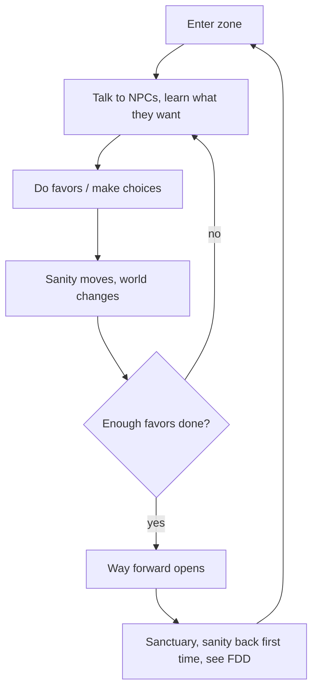
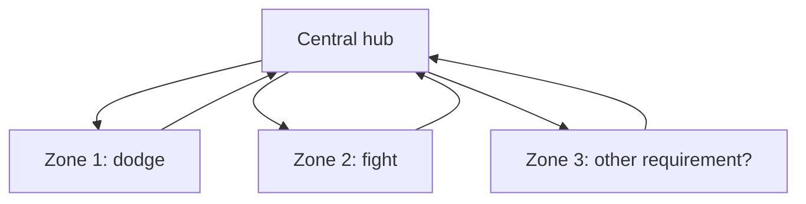

# Game Design Document

> see also: [FDD](<./FDD.md>) for functional, [TDD](<./TDD.md>) for technical

> sources: [Gameplay moodboard thingie](<./Gameplay moodboard thingie.canvas>), [cool canvas](<./cool canvas.canvas>), [deans moodboard](<./deans moodboard for huge breakthough project.canvas>), [Erin's visual ideas](<./Erin's visual ideas.canvas>)

> [!error] to dean, from dean
> becarefull of scope creep, and perfectionism. i love adding ideas (see whole doc)

## Content in Doc

- [General Info](<#General Info>)
- [General Description](<#General Description>)
- [Pitch Thing that Most Other GDD Related Stuff Have](<#Pitch Thing that Most Other GDD Related Stuff Have>)
	- [What the Player Should Feel](<#What the Player Should Feel>)
	- [What Game is NOT](<#What Game is NOT>)
	- [Comparable Games](<#Comparable Games>)
- [Story](<#Story>)
	- [Story Bible (Some Game Have like a Design Bible)](<#Story Bible (Some Game Have like a Design Bible)>)
- [World](<#World>)
	- [Zone Table](<#Zone Table>)
- [Cool Beginning Start of Game](<#Cool Beginning Start of Game>)
	- [First Tutorial Level](<#First Tutorial Level>)
- [Core Loop](<#Core Loop>)
- [Progression and Difficulty](<#Progression and Difficulty>)
- [Perspective and Visuals](<#Perspective and Visuals>)
- [Audio](<#Audio>)
- [UI / UX](<#UI / UX>)
- [Accessibility](<#Accessibility>)
- [Scope](<#Scope>)
	- [MRP (Minimal Game to Deliver)](<#MRP (Minimal Game to Deliver)>)
	- [Milestones](<#Milestones>)
	- [Cut List (First Things to Skip if Not Enough Time)](<#Cut List (First Things to Skip if Not Enough Time)>)
	- [Risks](<#Risks>)
- [Decisions](<#Decisions>)
- [Workflow / Production Thingies](<#Workflow / Production Thingies>)
- [Open Questions](<#Open Questions>)
	- [General / Pitch](<#Open Questions#General / Pitch>)
	- [Story](<#Open Questions#Story>)
	- [World](<#Open Questions#World>)
	- [Tutorial](<#Open Questions#Tutorial>)
	- [Core Loop / Progression](<#Open Questions#Core Loop / Progression>)
	- [Visuals](<#Open Questions#Visuals>)
	- [Audio](<#Open Questions#Audio>)
	- [UI / UX](<#Open Questions#UI / UX>)
	- [Accessibility](<#Open Questions#Accessibility>)
	- [Scope](<#Open Questions#Scope>)
	- [Workflow](<#Open Questions#Workflow>)
- [Refinement of Each Requirement](<#Refinement of Each Requirement>)

> [!NOTE]- who does what?
> Erin:
> - artstyle (sometimes asks dean for feedback)
> - artist
>
> Dean:
> - programmer
> - level design
>
> Mink:
> - miscellaneous worker ant
> - game development advice
> - idk maybe he can like play shitty guitar

---

## General Info

- GDD = what game is + vibe. [FDD](<./FDD.md>) = rules + numbers. [TDD](<./TDD.md>) = code
- sections = decided only. open stuff in [Open Questions](<#Open Questions>), big blocking ones in [Decisions](<#Decisions>)
- decision made? update its section + Open Questions + Decisions
- status: done (works in game) / designed (decided, not built) / open (needs decision)
- priority: must / should / could

## General Description

Psychological horror adventure driven by story and narrative, set in a closed world with multiple choice. It plays in a fantasy Celtic mythological faeric world. The main character slowly goes mentally insane.

Core pillars:
- 2.5D
- Nonlinear story/dialogue
- Fantasy Celtic mythologic faeric
- Psychological horror
- Strong story/narrative
- Sanity meter, changes how the game behaves
- Choices and consequences: what you say and do changes the course of the game
- Favors: talk to NPCs, trade favors, get things back
- Exploration: closed world, but you can go back and find hidden things

Mood: surreal/dreamlike, "whimsical horror", heavy atmosphere. 
see inspirations in: [deans moodboard for huge breakthough project](<./deans moodboard for huge breakthough project.canvas>), (mood/vibe only, not gameplay, narrative, 3d/2d, UI or artstyle).

## Pitch Thing (Most Other GDD Stuff Have)

one sentence, so anyone (in 6 months) knows tf is:

- human stuck in faerie world that slowly eats your mind. only way out: trade favors with things that lie for a living.

### What Player Should Feel

- early: curious, bit lost, tree feels safe
- middle: paranoid. cant tell whats real, cant tell who lies
- late: traded away something unrecoverable
- never: bored from grinding, cheated by fake choice. 
	- schoice have consequence, but that should not be explained, it should be felt

### What Game is NOT

deciding what its not collapses future choices and makes thing in the future be less work and more efficient:

- not combat focused game. combat is blocker, see [FDD](<./FDD.md>)
- not RPG with stats. no player levels
- not economy game. no shops, no currency, favors are money
- not open world. closed world, zones.
- not jump scare game. horror from atmosphere and sanity, not loud noises

### Comparable Games
references:

> [Gameplay moodboard thingie](<./Gameplay moodboard thingie.canvas>)
> [cool canvas](<./cool canvas.canvas>)

- Illusion Carnival (for: visuals)
- Yume 2kki (for: world structure)
- Octopath Traveler (for: 2.5D)
- Disco Elysium: sanity changes dialogue and perception
- Hollow Knight: small interconnected world, shortcuts, locked paths
- Darkwood: temporary safe spaces
- Majoras Mask: favors, NPC relationships
- Little Nightmares: environmental encounters
- Fire Emblem: everything has consequence
- Collective Unconscious (for: mood)
- Alice Madness Returns (for: mood)
- The Path (for: mood)
- Fran Bow (for: mood)
- The Excavation of Hobs Barrow (for: mood)
- Folklore (for: mood)
- Blacktail (for: mood)
- Bramble The Mountain King (for: mood)
- The Night of the Rabbit (for: mood)
- The Dark Eye Chains of Satinav (for: mood)
- Child of Light (for: art)
- Dragon Quest I&II HD-2D (for: art)
- Cinderia (for: art)
- Omori
- Undertale
- rayman 3
- celeste
- ENA dream bbq
- citizen sleeper
- deltarune
- pseudoregalia
- neva
- links awakening
- swordigo
- earthbound

## Story

really minimal, but the lore should not be the focus on now bc im mainly 1 guy

### Story Bible (Some Game Have Design Bible)

will change alot when we have writing and lore and such. 
(one short paragraph each is enough for now)

nothing decided yet, see: [Open Questions](<#Open Questions>).

## World

- Closed world, split into zones (idk, like some interconnected weave like yume 2kki ? <https://explorer.yume.wiki/>)
- handcrafted only, no procedural generation
- shortcuts unlock while exploring
- hub structure: not picked yet, options in [Open Questions](<#Open Questions>)

### Zone Table

| zone                           | mood      | teaches                   | NPCs / threats | unlocks          | status |
| ------------------------------ | --------- | ------------------------- | -------------- | ---------------- | ------ |
| 0 dying tree forest (tutorial) | safe, sad | talking, sanity, interact | the tree       | leave the forest |        |
| 1                              |           |                           |                |                  |        |

## Cool Beginning Start of Game

### First Tutorial Level
- You spawn in a forest with a large dying tree in the middle.(yggdrasil? deku tree? last of the great trees)
- You must interact with tree to progress, he will tell you he is dying and he will explain a little bit about the world youre in and how to survive.
- The area around the tree is a temporary safe hub
- You help the tree complete tasks and then he dies, the place he is in is no longer safe and you have to move on and survive with what youve learned

## Core Loop

FDD has sanity loop. this "tf player does" loop:

- every minute: walk, find something or someone, interact, choose
- every zone: arrive, learn rules, do favors for locals, find way forward, leave more damaged
- whole game: trade favors, sanity drops throughout, end somewhere

## Progression and Difficulty

Vibe of like progressing is that its hopeless, and you get like shit equipment.
player gains only:

- story (what you know)
- favors (who owes you, who you owe)
- items (mostly consumables, shit equipment)

difficulty rises by world getting stranger, not bigger numbers.

## Perspective and Visuals

- 2.5D, like Octopath Traveler or Illusion Carnival(and others, need to create link specific moodboards)
- Player is 2D
- Sprites always face the camera (also the player), so sides never need to be drawn
- Slight mouse lean adds depth without breaking the 2.5D look.
- camera rules: see Camera in [FDD](<./FDD.md>)
- Celtic-style elements are liked
- environment, player style and art style: not decided, see [Open Questions](<#Open Questions>). Owner: Erin.

## Audio

- Diverse and immersive music and sounds, as part of the atmosphere

## UI / UX

- menus, journal, controls: see [FDD](<./FDD.md>)

## Accessibility

horror + screen distortion can make people sick. color blind people and such.
this stuff comes later tho, should absolutly not be the focus now
can use: <https://github.com/Nokorpo/gato-godot-accessibility-toolkit>

- [x] remappable keys

## Scope

### MRP (Minimal Game to Deliver)

smallest version of game. if this is not fun, more zones wont fix it. and then we need to rethink stuff

- tutorial forest with dying tree
- one zone after it
- sanity working, 4 stages
- favors with real consequences
- one fake ending
- final art style for player + 1 area

### Milestones

- [ ] 1: MRP playable start to finish
- [ ] 2: 3 zones, true ending reachable
- [ ] 3: polish, audio, web build tested
- [ ] 4: release

rough timeline: pre-release after 1 year, full game (maybe) after 1.5-2 years

### Cut List (First Things to Skip)

1. hub upgrading
2. second fake ending
3. fun value

### Risks

- open decisions block stuff, see Decisions
- only Dean codes,
- Erin only artist, art takes longest and different timezone
- scope creep, i love adding ideas (see this whole doc)
- dean (de deanste dean/th3 seeker) is main driving force bc everyone else is busy

## Decisions

these block other stuff. smaller open stuff is in [Open Questions](<#Open Questions>).

| decision           | options                                         | owner       | due                     | result |
| ------------------ | ----------------------------------------------- | ----------- | ----------------------- | ------ |
| combat             | no combat / turn-based / real-time              | Dean        | before zone 1 design    |        |
| sanity 0           | fail forward / reload / ending                  | Dean        | before first playable   |        |
| true ending gating | hidden NPC / other                              | Dean + Erin | before dialogue writing |        |
| art style          | watercolor / acrylic / pixel player             | Erin        | before level art        |        |
| environment        | 3D / 2D layers                                  | Erin        | before level art        |        |
| hub structure      | central hub / small safe points / shrinking hub | Dean        | before zone 1 design    |        |
| isekai vs celtic   | isekai / set in celtic world directly           | Dean + Erin | before story bible      |        |
| game name + genre  | TBD                                             | all         | before devlog / discord |        |
## Workflow / Production Thingies

- Minimum 1 small progress step per week per person (draw 1 line, 1 bugfix, check in)
- ARCHIVE folder for old reusable assets (sorted with TagStudio)
- Funding
	- Simple donation [donations](<../donation.md>)
- [x] switch code licence GPLv2+ to EUPLv1.2+

## Open Questions

- not decided yet. 
	-decided? move up into its section, delete here. big ones also in [Decisions](<#Decisions>).

### General

- [ ] RPG? (core pillar or not)
- [ ] what will the Exact genre name be? idk tf to call it, name later if we are further in development? kinda important as then we can reference and compare our game to others and such.
- [ ] target player: story game people who tolerate discomfort (omori, undertale, lisa). not grinders
- [ ] no upgrade system?(godamnit) (perhaps later add small upgrades?)
- [ ] not "kill X monsters" quest game?
- [ ] comparable games: fill in what we take from Omori, Undertale, Illusion Carnival, Yume 2kki, Octopath Traveler
- [ ] more comparable games, find horror game with good sanity

### Story

- [ ] Fairies stole your name, trade favors to get it back (and maybe steal theirs). core loop "whole game" line depends on this
- [ ] Set it in the Celtic world directly instead of isekai-ing the main character (current draft: Celtic world does exist, but main character is not from it)
- [ ] **protagonist**: who, why here, wants what. what "slowly goes insane" looks like across game
	- Erin ideas ([Erin's visual ideas](<./Erin's visual ideas.canvas>)):
		- name parallel to celtic myth: Setante (cu chulainn, iron weapon vs fairies), Nechtan (sword of light), or modern name with celtic origin
		- or normal teen / young guy, struggling in school, mental health
		- introverted, nerdy, into celtic myth fiction
		- depression, maybe psychotic
		- escapes into books/games, maybe thats how he ends up in the realm
- [ ] **name**: what it does in this world, why fairies want it, what if never recovered
- [ ] **fairies**: one court or several? who is nice, who lies, who lies but nice
- [ ] **dying tree**: why dying, killed by what, returns later?
- [ ] **world rules** (fae cant lie? iron? food? usual celtic stuff, which to keep, which to drop)
	- weakness fairies?: iron? big in story, way to "defeat" fairies (Setante idea)
- [ ] **themes**: what it is about under the horror
- [ ] **ending structure**:
	- fake ending (good/bad side)
	- true ending (hidden)
	- sanity 0 ending? (see sanity 0 in the [FDD](<./FDD.md>))
- [ ] **tone rules**: what whimsical horror allows. gore? body horror? child characters? write down so Erin and Dean dont guess differently
- [ ] content warnings for store page / game start

### World

- [ ] Eventually find someone for map design and level structuring
- [ ] hub structure, pick one (see Decisions):
	- A) Central hub where you dive deeper into the fairy realm, each zone with its own requirements (one where you dodge, one where you fight, etc)
		- from [Gameplay moodboard thingie](<./Gameplay moodboard thingie.canvas>) (Hollow Knight): 1 central forest, 3 areas branch off, each area has 1 access requirement
	- B) instead of hub world, multiple small safe points.
	- C) when progressing, hub/safeword will become smaller and you have to do more yourself
		- (like BOTW/TOTK great deku tree forst mist, and you can unlock more of the mist, but your safe zone also shrinks and such. also like a favor system? idk tho)
		- both?
	- upgrade your hub world????

option A sketch:

### Tutorial

- [ ] how many tasks for the tree

### Core Loop / Progression

- [ ] "skill" part? movement is all in code (dash, wall jump), where is it used. dodge zones? platforming between NPCs? decide with zone table
- [ ] zone length
- [ ] abilities / movement unlocks (zone table decides)
- [ ] easy mode / lower sanity drain? probably, see accessibility
- [ ] pacing: first real scare, first "oh no" moment

### Visuals

- [ ] Environment built in Blender (3D props/environments) or as 2D layers rendered on top of each other like Illusion Carnival?
	- Owner: Erin. 
- [ ] Player style:
	- [ ] low-res/pixel player against high-res surroundings
	- [ ] unique non-pixel style
	- Owner: Erin.
- [ ] Art style: see for exact drawing and inspirations and inspirations [Erin's visual ideas](<./Erin's visual ideas.canvas>) 
	- Erin vote: 2D painterly watercolor, maybe 3D if time allows
	- Dean vote: the first painterly blitch/arcyllic, and the painterly watercolor style
	- Owner: Erin.
- [ ] Separate moodboards/example canvases for gameplay and artstyle
	- Owner: Dean.

### Audio

- [ ] sanity changes audio too (muffled, wrong sounds, detuned music).
- [ ] music theme per zone or 1 warped theme that gets more garbled as progression and choises?
- [ ] sound source (own recordings, free libraries) and licence

### UI

- [ ] HUD: sanity meter always visible, only when low, or never (world only)?
- [ ] dialogue box style, must match art style, wait for Erin

### Accessibility

- [ ] photosensitivity: carefull with fast flashing. test sanity distortion
- [ ] toggle for screen distortion / camera shake strength
- [ ] subtitles for important sounds
- [ ] colorblind check, esp if real vs fake enemies differ by color only

### Scope

- [ ] MRP: favors with real consequences, how many
- [ ] milestone 1 date

### Workflow

- [ ] Friends can join temporarily, or permanently as extra teammates, does need discusion
- [ ] Devlog/blogpost: weekly or other?
- [ ] Discord community server (when?)
- [ ] Shared gmail address?
- [ ] update github organisation page
- [ ] image for game dev group
- [ ] exclusive updates for donators or not?

## Refinement of Each Requirement

Refine each requirement and include drawings below.
- for now just check the mermaid diagrams, will do drawings later