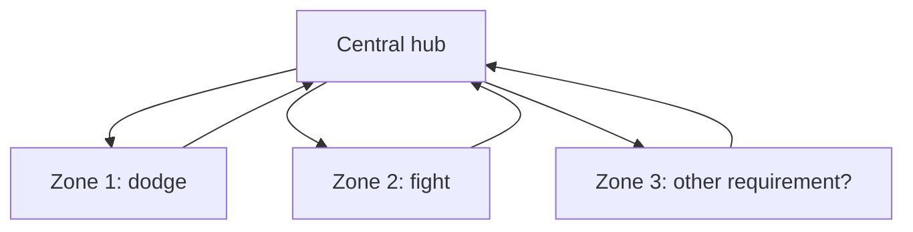

# Game Design Document

> this doc is game/vision oriented

> see also: [FDD](<./FDD.md>) for functional, [TDD](<./TDD.md>) for technical

Legend:
- bullet: decided
- `[ ]` still to decide

> [!NOTE]- who does what?
> Erin:
> - artstyle
> - artist
>
> Dean:
> - programmer
> - level design
>
> Mink:
> - miscellaneous worker ant
> - game development advice
> - idk maybe he can like play shitty guitar

---
# Cool Beginning Start of Game

#### First Tutorial Level
- You spawn in a forest with a large dying tree in the middle
- You must interact with tree to progress, he will tell you he is dying and he will explain a little bit about the world you're in and how to survive.
- The area around the tree is a temporary safe hub
- You help the tree complete a few tasks and then he dies, the place he is in is no longer safe and you have to move on and survive with what youve learned

- sanity point needs to be concrete, like in how it works and what you get from it.

## General Description

Psychological horror adventure driven by story and narrative, set in a closed world with multiple choice. It plays in a fantasy Celtic mythological faeric world. The Celtic world does exist, but the main character is not from it. The main character slowly goes mentally insane. (can ofc be changed)

Core pillars:
- 2.5D
- Nonlinear story/dialogue
- Fantasy Celtic mythologic faeric
- Psychological horror
- Strong story/narrative
- [ ] RPG?
- Sanity meter

Mood: surreal/dreamlike, "whimsical horror", heavy atmosphere. 
see inspirations in: [deans moodboard for huge breakthough project](<./deans moodboard for huge breakthough project.canvas>), (mood/vibe only, not gameplay, narrative, 3d/2d, UI or artstyle).

the vibe of like progressing is that its hopeless, and you get like shit equipment?

> [!question] Unclear
> - [ ] what will the Exact genre name be? idk tf to call it, name later if we are further in development? kinda important as then we can reference and compare our game to others and such.

## Perspective and Visuals

- 2.5D, like Octopath Traveler or Illusion Carnival(and others, need to create link specific moodboards)
- Player is 2D, third person camera and viewpoint
- Sprites always face the camera (also the player), so sides never need to be drawn
- [ ] Environment built in Blender (3D props/environments) or as 2D layers rendered on top of each other like Illusion Carnival?
	- Owner: Erin. 
- [ ] Player style:
	- [ ] low-res/pixel player against high-res surroundings
	- [ ] unique non-pixel style
	- Owner: Erin.
- [ ] Art style: see for exact drawing and inspirations and inspirations [Erin's visual ideas](<./Erin's visual ideas.canvas>) 
	- Erin vote: 2D painterly watercolor, maybe 3D if time allows
	- Dean vote: the first painterly blitch/arcyllic, and the painterly watercolor style
	- Celtic-style elements are liked
	- Owner: Erin.
- [ ] Separate moodboards/example canvases for gameplay and artstyle
	- Owner: Dean.

## Stuff

- Sanity: a meter that changes how the game behaves
- Choices and consequences: what you say and do changes the course of the game
- Favors: talk to NPCs, trade favors, get things back
- Exploration: closed world, but you can go back and find hidden things
- no upgrade system
- no level system (no player levels)

## Story

- see [Erin's visual ideas](<./Erin's visual ideas.canvas>) for erin minimum storyboard

 - [ ] Fairies stole your name, trade favors to get it back (and maybe steal theirs)
 - [ ] Set it in the Celtic world directly instead of isekai-ing the main character

## World

- Closed world, split into zones (idk, like some interconnected weave like yume 2kki ? <https://explorer.yume.wiki/>)
- Checkpoints and level progress are saved
- [ ] Eventually find someone for map design and level structuring
- [ ] Central hub where you dive deeper into the fairy realm, each zone with its own requirements (one where you dodge, one where you fight, etc)
- instead of hub world, multiple small safe points.
- OR when progressing, hub/safeword will become smaller and you have to do more yourself
	- (like BOTW/TOTK great deku tree forst mist, and you can unlock more of the mist, but your safe zone also shrinks and such. also like a favor system? idk tho)
	- both?
- upgrade your hub world????

World structure idea visualized by dean:

## Audio

- Diverse and immersive music and sounds, as part of the atmosphere

## Workflow / Production Thingies

- Minimum 1 small progress step per week per person (draw 1 line, 1 bugfix, check in)
- ARCHIVE folder for old reusable assets (sorted with TagStudio)
- Erin does artstyle and sometimes ask dean for feedback
- Dean does level design
- Friends can join temporarily, or permanently as extra teammates, does need discusion
- Funding
	- Simple donation [donations](<../donation.md>)
- [ ] Devlog/blogpost: weekly or other?
- [ ] Discord community server (when?)
- [ ] Shared gmail address?

## Refinement of Each Requirement

Refine each requirement and include drawings below.
- for now just check the mermaid diagrams, will do drawings later